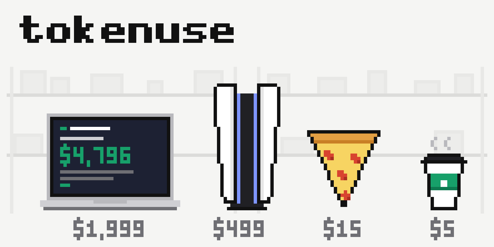

# tokenuse



What your Claude Code usage would have cost at API prices, and what that money could have bought.

```
$ npx tokenuse-cli --paid 200

Claude Code usage 2026-08-24 → 2026-09-25  (682 sessions, 27,106 messages)

┌──────────────────┬────────┬─────────┬─────────────┬───────────────┬────────────┬───────────┐
│ Model            │   Msgs │   Input │     Cache W │       Cache R │     Output │      Cost │
├──────────────────┼────────┼─────────┼─────────────┼───────────────┼────────────┼───────────┤
│ claude-opus-5    │ 19,407 │  38,833 │  99,696,860 │ 3,001,514,272 │ 10,040,076 │ $2,653.12 │
│ claude-fable-5-1 │  4,033 │ 154,235 │  46,480,446 │   855,239,815 │  5,950,526 │ $1,408.32 │
│ ...              │        │         │             │               │            │           │
├──────────────────┼────────┼─────────┼─────────────┼───────────────┼────────────┼───────────┤
│ TOTAL            │ 27,106 │ 860,776 │ 164,827,066 │ 4,619,234,261 │ 19,480,902 │ $5,013.53 │
└──────────────────┴────────┴─────────┴─────────────┴───────────────┴────────────┴───────────┘

  At API prices you would have paid       $5,013.53
  Subscription (33 days at $200.00/mo)  -   $216.82
  ─────────────────────────────────────────────────
  You saved                               $4,796.71

  That's the same as:

  2 × MacBook Pro 14"
          ________________________
         /                        \
        .-------------------------------------.
        |  .-------------------------------.  |
        |  |                               |  |
        |  |  $ tokenuse                   |  |
        |  |                               |  |
        |  |  You saved  $4,796.71         |  |
        |  |  That's the same as:          |  |
        |  |                               |  |
        |  |                               |  |
        |  '-------------------------------'  |
        |             ___________             |
   _____|____________/___________\____________|_____
  |_________________________________________________|

  1 × PlayStation 5
  ...
```

Inspired by [ccusage](https://github.com/ryoppippi/ccusage). Reads the same local logs, adds the subscription deduction and the shopping list.

## Run

Needs Node 20+ (or Bun). No install, no dependencies.

```
npx tokenuse-cli
npx tokenuse-cli --paid 200            # deduct your subscription, prorated per day
npx tokenuse-cli --by day              # model (default) | day | week | month | session
npx tokenuse-cli --since 2026-09-01    # dates are in your local time zone
npx tokenuse-cli --update-prices       # refresh prices from LiteLLM
```

`bunx tokenuse-cli` works too. Or clone and run `node tokenuse.mjs`. To get `tokenuse` on your PATH from the clone: `npm link`.

## How it works

1. Scans `~/.claude/projects/**/*.jsonl` (or `$CLAUDE_CONFIG_DIR/projects`).
2. Keeps assistant messages with usage, deduplicated by message id.
3. Prices input, cache write (5m and 1h), cache read and output tokens per model.
4. Groups days, weeks and months by your local time zone.
5. Subtracts `--paid` prorated over the days in the report.
6. Spends the rest on the priciest items that fit, and draws them.

Everything lives in one file, `tokenuse.mjs`. Prices are the `PRICES` table at the top, items and art are the `ITEMS` array.

## Prices

Built in from Anthropic's public API pricing as of June 2026, so a normal run makes no network calls. `--update-prices` downloads [LiteLLM's price table](https://github.com/BerriAI/litellm/blob/main/model_prices_and_context_window.json) once and caches the Claude entries in `~/.cache/tokenuse/prices.json`, which then takes precedence. Delete that file to go back to the built-in prices. A model missing from both shows as "unpriced" at $0.

## Note on log retention

Claude Code deletes session logs older than 30 days. To keep history, set `"cleanupPeriodDays": 365` in `~/.claude/settings.json`.

## License

MIT
